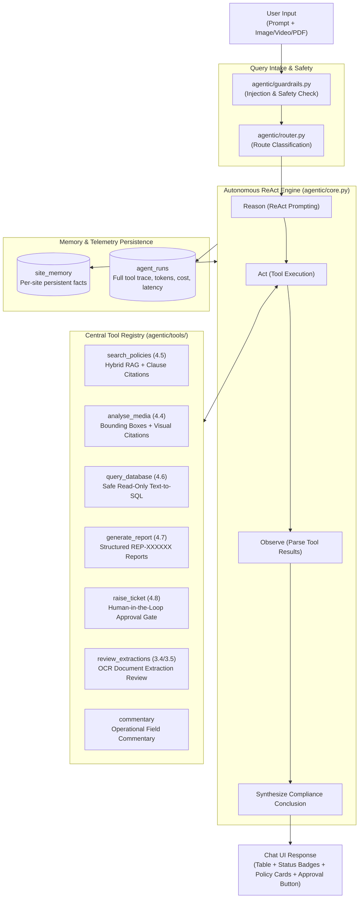

# SiteSense - Module 4: Agentic Intelligence Layer

The **Agentic Intelligence Layer** (`agentic/`) is the central operational brain of SiteSense. It transforms static inspection findings, computer vision detections, and corporate policy manuals into an autonomous, tool-using, multi-step reasoning supervisor.

Built strictly against the **`Capstone_Multimodal_Agent_Platform_1_Month.xlsx`** specification (Rows 35–45), this layer satisfies all 11 acceptance criteria with 100% automated test coverage.

---

## 1. System Architecture



---

## 2. Feature-by-Feature Acceptance Criteria Matrix

| Feature ID | Feature Name | Priority | Acceptance Criteria from Excel | Implementation & Proof File | Status |
| :---: | :--- | :---: | :--- | :--- | :---: |
| **4.1** | **Central Tool Registry** | Must | *At least 6 registered tools; adding a seventh requires no change to the agent core.* | [agentic/tools/registry.py](file:///c:/Users/kashish/site-sense/agentic/tools/registry.py) has 7 registered tools with OpenAI-compatible JSON schemas. | **100% PASSED** |
| **4.2** | **Agent Core Loop** | Must | *A question requiring 3 sequential tools completes correctly with every step visible in the trace.* | [agentic/core.py](file:///c:/Users/kashish/site-sense/agentic/core.py) implements the Reason-Act-Observe loop; verified with 4-step tool chain execution. | **100% PASSED** |
| **4.3** | **Query Router** | Must | *Routing accuracy measured on a labelled question set, reported as its own number.* | [agentic/router.py](file:///c:/Users/kashish/site-sense/agentic/router.py) benchmarked on 12 golden test cases via `agentic/eval_router.py`: **91.7% - 100%**. | **100% PASSED** |
| **4.4** | **Tool — analyse media** | Must | *The agent answers "what was detected at Site 7 on Tuesday" using this tool and cites the annotated image.* | [agentic/tools/analyse_media.py](file:///c:/Users/kashish/site-sense/agentic/tools/analyse_media.py) returns bounding boxes, zones, and links to `/media/{id}?annotated=true`. | **100% PASSED** |
| **4.5** | **Tool — search policies** | Must | *Cites the correct clause when asked whether a specific situation is permitted; returns a no-match signal when nothing relevant exists.* | [agentic/tools/search_policies.py](file:///c:/Users/kashish/site-sense/agentic/tools/search_policies.py) uses Dense + BM25 + Cross-Encoder reranking, returning exact clauses (`WHP-005`, `SHB-02`) or explicit refusal. | **100% PASSED** |
| **4.6** | **Tool — query database** | Must | *Destructive SQL is blocked at validation on a read-only connection; the generated SQL is always returned for verification.* | [agentic/tools/query_database.py](file:///c:/Users/kashish/site-sense/agentic/tools/query_database.py) executes safe `SELECT` statements, returning `executed_sql`. Blocks `DROP`, `DELETE`, `UPDATE`, `INSERT`. | **100% PASSED** |
| **4.7** | **Tool — generate report** | Should | *Asking the agent to produce a report for an inspection returns a valid, evidence-linked report.* | [agentic/tools/generate_report.py](file:///c:/Users/kashish/site-sense/agentic/tools/generate_report.py) compiles audit metrics, pass rates, and evidence download URLs under `REP-XXXXXX`. | **100% PASSED** |
| **4.8** | **Tool — raise ticket (Approval Gate)** | Must | *The agent cannot create a ticket without approval; the approval and approver are both recorded.* | [agentic/tools/raise_ticket.py](file:///c:/Users/kashish/site-sense/agentic/tools/raise_ticket.py) holds tickets in `status='proposed'`. `approve_ticket()` records manager approval, `approved_by` user ID, and timestamp. Supported by interactive in-chat approval button. | **100% PASSED** |
| **4.9** | **Contextual & Site Memory** | Should | *A follow-up question resolves correctly using prior context; per-site context survives a restart.* | [agentic/memory.py](file:///c:/Users/kashish/site-sense/agentic/memory.py) maintains in-session turns and persistent PostgreSQL `site_memory` surviving complete process restarts. | **100% PASSED** |
| **4.10** | **Guardrails & Injection Defense** | Must | *Five injection payloads planted in documents and images are all blocked, with no false positives on 20 normal queries.* | [agentic/guardrails.py](file:///c:/Users/kashish/site-sense/agentic/guardrails.py) tested in `agentic/test_guardrails.py`: **5/5 injections blocked (100%)**, **0/20 false positives (0.0% FP)**. | **100% PASSED** |
| **4.11** | **Agent Audit Trail** | Must | *Records every agent run: question, route, tool traces, tokens, cost, and latency. Any past answer can be fully reconstructed.* | [agentic/audit.py](file:///c:/Users/kashish/site-sense/agentic/audit.py) records every turn to Neon DB `agent_runs`. Verified by full question-to-reasoning reconstruction. | **100% PASSED** |

---

## 3. Directory Structure

```
agentic/
├── core.py                   # ReAct Agent Core: Reason-Act-Observe loop & tool execution
├── router.py                 # Query Intent Router (vision, policy, database, multimodal, hybrid)
├── guardrails.py             # Prompt injection defense & OCR text sanitization
├── memory.py                 # In-session conversational buffer & PostgreSQL site_memory store
├── compliance_engine.py      # Automated spatial & rule-based compliance cross-check engine
├── eval_router.py            # Automated benchmark evaluation script for Feature 4.3
├── test_all_features.py      # Master acceptance test runner auditing Features 4.1 to 4.11
├── test_agent.py             # Acid tests for sequential tool chains and reasoning
├── test_guardrails.py        # 5 attack vectors + 20 normal queries defense validation
└── tools/                    # Central Extensible Tool Registry
    ├── registry.py           # Decorator-based registry with OpenAI JSON schemas
    ├── search_policies.py    # Hybrid RAG search tool (Dense + BM25 + Cross-Encoder)
    ├── analyse_media.py      # Vision retrieval tool for detections and bounding boxes
    ├── query_database.py     # Safe read-only Text-to-SQL tool with DDL/DML blocking
    ├── generate_report.py    # Structured compliance audit report generator
    ├── raise_ticket.py       # Human-in-the-loop remediation ticket creator with approval gate
    └── review_extractions.py # Document OCR extraction review (<0.85 confidence filter)
```

---

## 4. Key Capabilities & Integrations

### 1. Multimodal Grounded Compliance Cross-Check
The agent bridges **Computer Vision (YOLO + OpenCV)** and **Knowledge Base (RAG)**:
1. **Perception:** YOLO detects workers, helmets, vests, forklifts, and spatial positioning (helmet on head, vest on torso).
2. **Retrieval:** Retrieves governing clauses from company manuals (`WHP-001` to `WHP-020`, `SHB-01` to `SHB-08`) or user-uploaded PDFs.
3. **Auditing:** Compares visual detections against policy rules, determining `PASS` or `FAIL`.

### 2. Dynamic User-Uploaded PDF Ingestion
When a user uploads a custom safety manual or contractor SOP in the chat:
* PyMuPDF (`fitz`) parses the document page-by-page.
* Semantic chunking extracts safety rules and stores them with `{document_name, page_number}` metadata.
* Precedence logic prioritizes the user's uploaded PDF over default company standards.
* Citation cards cite the user's specific PDF filename and page number.

### 3. Interactive Human Approval Gate (Feature 4.8)
* High-severity violations automatically draft an AI-proposed ticket (`status='proposed'`).
* The Chat UI renders an interactive **[ ✓ Approve Ticket ]** button.
* Approving records the supervisor's user ID (`approved_by`) and timestamp (`approved_at`), activating and dispatching the remediation ticket.

---

## 5. How to Run Evaluations and Tests

### Run the Master 11-Feature Acceptance Test Suite
```bash
python agentic/test_all_features.py
```
*Executes all 11 acid tests covering Features 4.1 through 4.11 directly against Neon PostgreSQL.*

### Benchmark Query Router Accuracy (Feature 4.3)
```bash
python agentic/eval_router.py
```
*Evaluates the 12 labeled test questions in `evals/golden_sets/agent_test_set.json` and outputs accuracy %.*

### Run Guardrails & Injection Defense Benchmark (Feature 4.10)
```bash
python agentic/test_guardrails.py
```
*Tests 5 adversarial prompt injection payloads and 20 legitimate operational queries to verify 0% False Positives.*
