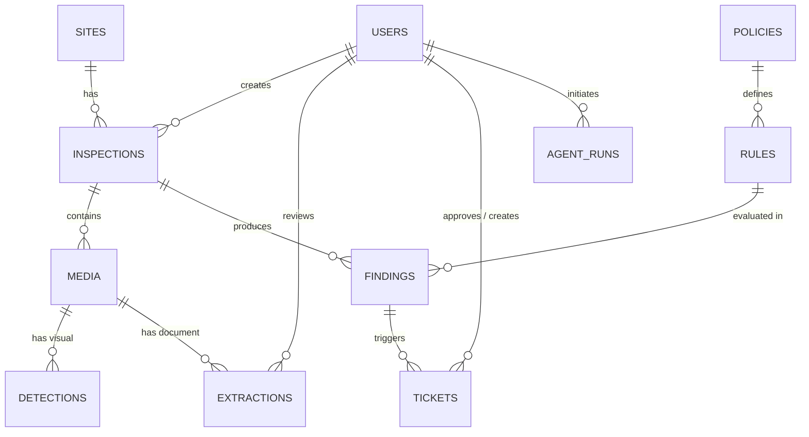

# SiteSense - Core Data Model

This repository houses the database models, SQL migrations, and initialization scripts for **SiteSense: Multimodal Operations Intelligence Platform** hosted on **Neon PostgreSQL**.

---

## 1. Core Data Model Overview

The 11 core tables specified in the **Week 1 Architecture Specification**:

| # | Table | Key Fields | Purpose / Notes |
|---|---|---|---|
| 1 | `sites` | `id`, `name`, `type`, `location`, `active` | Physical locations being inspected (stores, warehouses, depots). |
| 2 | `users` | `id`, `name`, `email`, `role` | Role-based access control (`admin`, `manager`, `field`, `reviewer`). |
| 3 | `inspections` | `id`, `site_id`, `user_id`, `created_at`, `status`, `job_id` | One upload session from one site with async job tracking. |
| 4 | `media` | `id`, `inspection_id`, `type`, `path`, `metadata` | Every uploaded file (`image`, `video`, `doc`) and its storage path. |
| 5 | `detections` | `id`, `media_id`, `class_name`, `bbox`, `confidence`, `zone`, `frame_no` | One row per detected object; bounding boxes in `xyxy` absolute pixels. |
| 6 | `extractions` | `id`, `media_id`, `field_name`, `value`, `confidence`, `reviewed_by` | Structured fields pulled from documents with confidence scoring. |
| 7 | `policies` | `id`, `title`, `version`, `source_file`, `effective_date` | Policy documents that compliance rules are checked against. |
| 8 | `rules` | `id`, `name`, `description`, `rule_type`, `parameters`, `policy_ref` | Machine-readable compliance rules mapped to policy clauses. |
| 9 | `findings` | `id`, `inspection_id`, `rule_id`, `status`, `evidence_ids` | Rule evaluation results (`pass`, `fail`, `review`) with linked detections. |
| 10 | `tickets` | `id`, `finding_id`, `status`, `created_by`, `approved_by` | Remediation actions raised from failures; agent proposes, human approves. |
| 11 | `agent_runs` | `id`, `user_id`, `question`, `route`, `tools_called`, `tokens`, `cost`, `latency` | Full audit trail and token/cost telemetry for agent queries. |

---

## 2. Entity-Relationship Diagram



---

## 3. Files

- **`schema.sql`**: Production DDL script for PostgreSQL/Neon including UUID generation (`pgcrypto`), check constraints, foreign keys, cascades, and query indexes.
- **`models.py`**: Modern SQLAlchemy 2.0 ORM declarations with type annotations and bidirectional relationships.
- **`init_db.py`**: Python script that reads the schema and applies it to Neon DB with validation checks.
- **`seed_db.py`**: Populates valid test records across all 11 tables for integration testing and development.
- **`.env`**: Neon Database connection URL.

---

## 4. How to Run

### Initialize Database Schema in Neon:
```bash
python init_db.py
```

### Seed Initial Sample Data:
```bash
python seed_db.py
```

